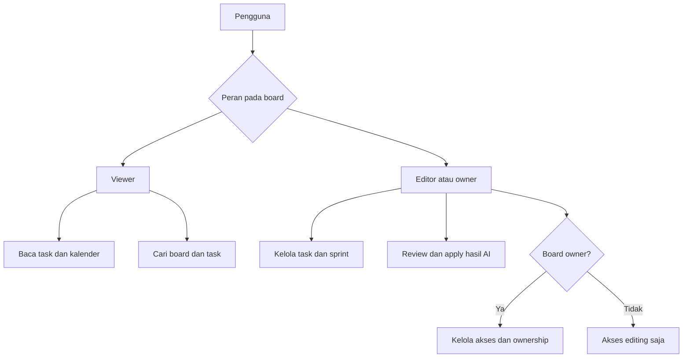
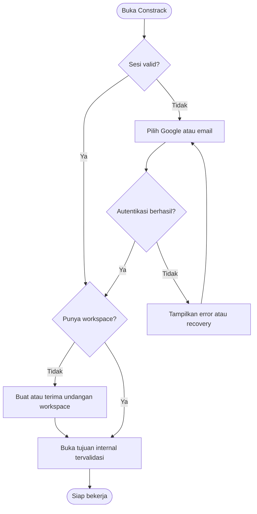
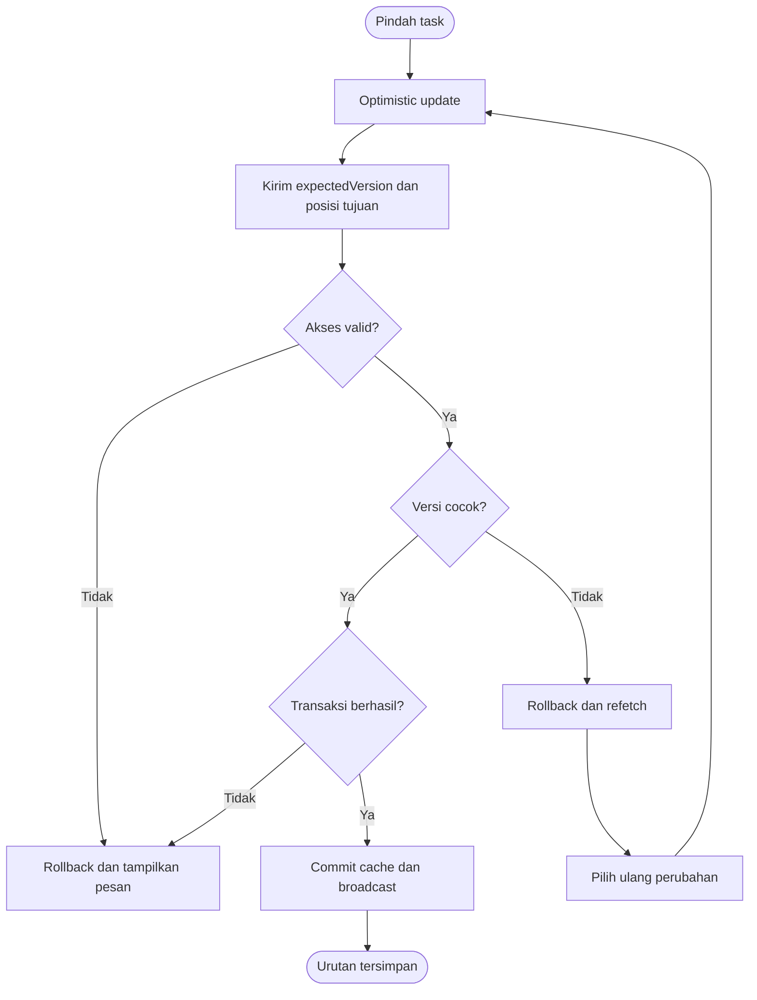
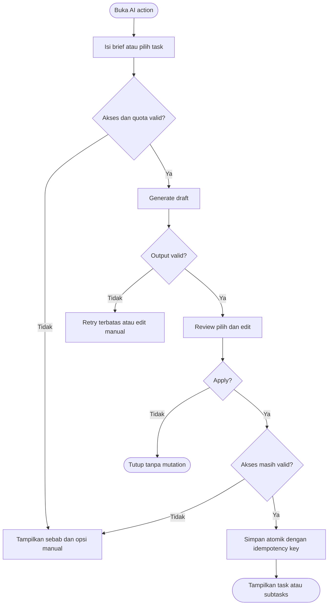
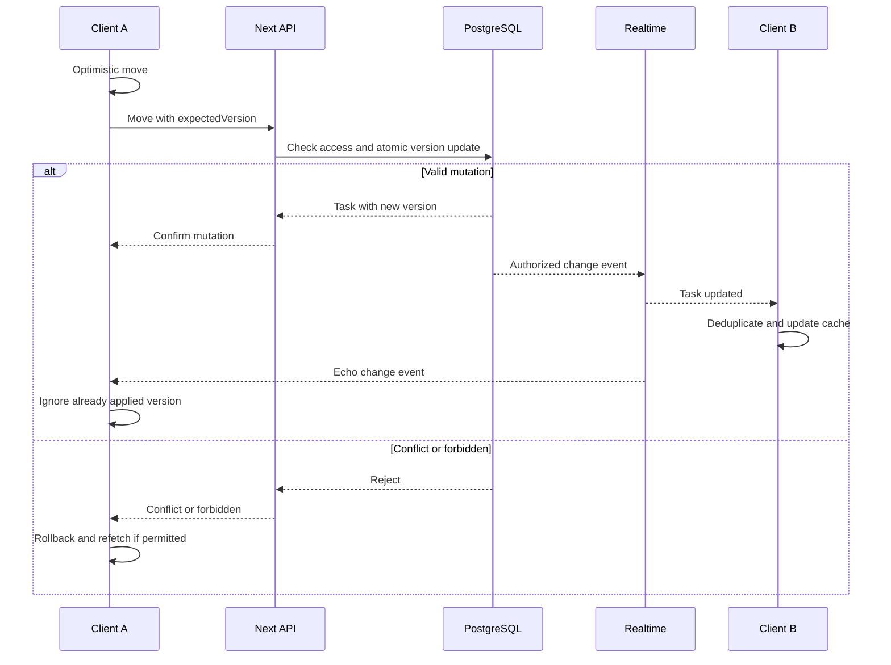
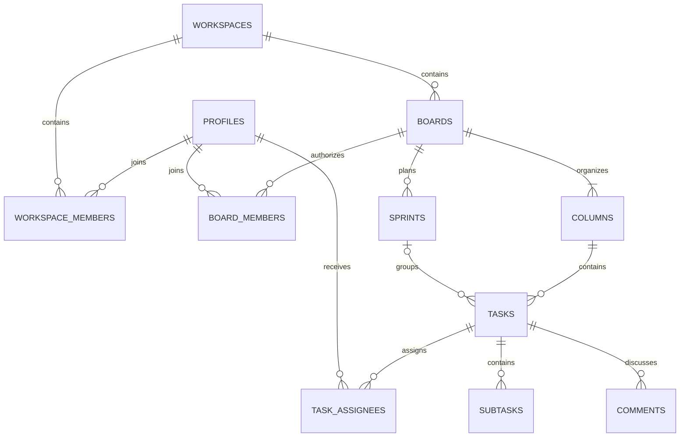

# Constrack — Spesifikasi Aplikasi & UI Awal

Versi 0.1 · 17 Oktober 2026 · Status: proposal siap diturunkan menjadi backlog

Pendamping: `Constrack-01-Blueprint.md`. Bahasa dokumentasi Indonesia; contoh UI memakai English. Semua nama proyek, task, dan angka pada wireframe adalah data contoh. Diagram memakai Mermaid; renderer Markdown tanpa Mermaid akan menampilkan source diagram. Wireframe merupakan struktur awal, bukan screenshot aplikasi jadi.

## 1. Tujuan, scope, dan asumsi

Membangun aplikasi AI Kanban dengan Next.js App Router, TypeScript, shadcn/ui, Animate UI, Tailwind CSS, Framer Motion, Lucide/Hugeicons, dan Redux Toolkit. Backend usulan: Supabase untuk PostgreSQL, Auth, Realtime. AI: Gemini API dengan model free-tier yang tersedia saat implementasi.

### Scope rilis pertama

- Homepage; Google/email login, registrasi, verifikasi, reset password.
- Workspace dan board membership; board/task/subtask CRUD dan archive.
- Kanban drag & drop, dashboard, My Tasks, calendar, team, settings.
- Search command menu, comments, notifications, presence dan realtime updates.
- Sprint dasar; AI generation, breakdown, summary dengan review sebelum apply.
- Responsive desktop/tablet/mobile dan akses keyboard.

### Di luar scope awal

Billing, native mobile app, offline writes, rich-text co-editing berbasis CRDT, Gantt, automation builder, public board, file attachments, dan direktori global seluruh pengguna. Kolaborasi realtime berarti sinkronisasi data/presence; bukan mengetik bersama pada satu dokumen.

### Keputusan awal

| Topik | Keputusan proposal |
|---|---|
| Workspace | User dapat tergabung di beberapa workspace; satu workspace aktif |
| Board visibility | Private kepada anggota eksplisit; workspace admin tidak otomatis membaca isi board |
| Pembuatan board | Semua anggota aktif boleh membuat board; creator menjadi board owner |
| Assignee | Multi-assignee; hanya anggota board aktif |
| Due date | Date-only `YYYY-MM-DD`, bukan timestamp deadline |
| Minggu kerja | Senin–Minggu menurut timezone pengguna |
| Sprint | Satu task maksimal satu sprint saat ini; satu active sprint per board |
| Archive | Dikeluarkan dari metrik/default search; dapat direstore oleh editor/owner |
| Delete | Permanent delete hanya owner board; dialog konfirmasi; ditunda jika belum dibutuhkan |
| Ownership | Transfer sebelum owner meninggalkan board/workspace |

## 2. Aktor dan authorization

| Aktor | Kemampuan |
|---|---|
| Visitor | Membaca homepage, login, register, recovery |
| Authenticated user | Profil sendiri, workspace yang diikuti, logout |
| Workspace owner | Pengaturan workspace, anggota, transfer ownership |
| Workspace admin | Invite/remove anggota biasa, pengaturan tim; tidak mengubah owner |
| Workspace member | Melihat direktori tim dan membuat board |
| Board owner | Isi board, anggota board, settings, ownership, deletion |
| Board editor | Membaca/membuat/mengubah task, komentar, sprint, menggunakan AI |
| Board viewer | Membaca board, task, komentar, summary; tanpa mutation |
| Gemini API | Menghasilkan draft berdasarkan konteks yang diberikan server |

Workspace role dan board role berbeda. Akses board harus melewati membership workspace aktif DAN board membership aktif. Penghapusan workspace member mencabut semua akses board pada workspace tersebut. Pemindahan ownership diperlukan jika pengguna memiliki board.

### Matriks izin

| Operasi | Viewer | Editor | Board owner | Workspace admin tanpa board membership |
|---|---|---|---|---|
| Read board/search task | Ya | Ya | Ya | Tidak |
| Create/edit/move/archive task | Tidak | Ya | Ya | Tidak |
| Comment/mention | Tidak | Ya | Ya | Tidak |
| Generate/apply AI | Tidak | Ya | Ya | Tidak |
| Manage sprint | Tidak | Ya | Ya | Tidak |
| Rename/reorder columns | Tidak | Ya | Ya | Tidak |
| Invite/change board role | Tidak | Tidak | Ya | Tidak |
| Delete/transfer board | Tidak | Tidak | Ya | Tidak |

Semua pemeriksaan berlaku di server dan database/RLS. Tombol disabled bukan kontrol keamanan. Search, chart, realtime channel, notifications, dan AI context mengikuti scope yang sama.

## 3. Kebutuhan fungsional

| ID | Requirement | Acceptance ringkas |
|---|---|---|
| FR-01 | Google/email authentication | Login berhasil masuk tujuan internal; error tidak menghapus isian aman |
| FR-02 | Workspace onboarding | Pengguna baru membuat workspace atau menerima invitation |
| FR-03 | Board management | Create/rename/archive/restore sesuai role; owner dan membership tercipta atomik |
| FR-04 | Task management | Validasi, assignment, priority, dates, labels, comments, subtasks |
| FR-05 | Drag & drop | Move/sort tersimpan atomik; gagal melakukan rollback |
| FR-06 | Dashboard | Counts, Breakdown, Compositions, recent boards konsisten |
| FR-07 | My Tasks | Hanya assignment pengguna; cards default; filter/sort/list bekerja |
| FR-08 | Calendar | Menampilkan task accessible by due date serta Unscheduled |
| FR-09 | Team | Direktori workspace, invitation, role management sesuai izin |
| FR-10 | Command menu | ⌘K/Ctrl+K; navigation, boards, tasks, actions, help |
| FR-11 | Realtime | Update sesi lain, presence, reconnect/refetch |
| FR-12 | Notifications | Assignment/mention/invite; read/unread dan deep link |
| FR-13 | AI generation | Draft terstruktur; pilih/edit/apply; tidak langsung menyimpan |
| FR-14 | AI breakdown | Subtasks draft terkait satu task, tanpa duplikasi saat retry |
| FR-15 | Sprint summary | Fakta dari snapshot terukur; narasi dan rekomendasi dibedakan |
| FR-16 | Settings/profile | Nama/avatar/timezone/preferensi tersimpan; email diverifikasi |
| FR-17 | Responsive shell | Sidebar collapse desktop/drawer mobile; state persisten |

## 4. Katalog use case

| ID | Use case | Aktor | Hasil |
|---|---|---|---|
| UC-01 | Register/login | Visitor | Sesi valid dan workspace dipilih |
| UC-02 | Create board | Workspace member | Board serta kolom default dibuat |
| UC-03 | Create/edit task | Board editor/owner | Task valid disimpan dan tercatat |
| UC-04 | Move task | Board editor/owner | Kolom/urutan berubah dan tersinkron |
| UC-05 | Find assigned work | Member | My Tasks terfilter |
| UC-06 | Search/jump | Member | Task/board/page dibuka |
| UC-07 | Generate tasks | Board editor/owner | Task terpilih dibuat dari draft |
| UC-08 | Break down task | Board editor/owner | Subtasks terpilih ditambahkan |
| UC-09 | Summarize sprint | Board editor/owner | Snapshot summary tersimpan |
| UC-10 | Invite collaborator | Board owner / workspace admin | Invitation diterima atau kedaluwarsa |
| UC-11 | Review calendar | Board member | Task bertanggal ditemukan |
| UC-12 | Update profile/logout | User | Profil diperbarui/sesi diakhiri |

### Peta use case inti

Diagram berikut merupakan peta use case berbentuk flowchart, bukan notasi UML use-case formal.

### UC-01 — Register/login

- Precondition: user berada di halaman publik; return URL internal bila ada.
- Main flow: pilih Google atau email → autentikasi → server memverifikasi sesi → cek workspace → onboarding/pilih workspace → halaman tujuan.
- Registrasi email menampilkan instruksi verifikasi; akun belum terverifikasi tidak boleh memakai workspace protected.
- Alternatives: OAuth dibatalkan, invalid credential, verifikasi kedaluwarsa, rate limit; tampilkan tindakan retry/recovery yang sesuai.
- Postcondition: sesi aktif; data pengguna lain tidak tertinggal di client cache.

### UC-02 — Create board

- Precondition: membership workspace aktif.
- Main flow: New board → nama (1–80 karakter setelah trim), deskripsi opsional (maks. 500) → submit → server membuat board, owner membership, kolom default dalam satu transaksi → buka board.
- Alternative: request gagal, tampilkan error dan pertahankan form; retry memakai idempotency key yang sama.
- Postcondition: board muncul pada Owned by you dan All boards.

### UC-04 — Move task

- Precondition: editor/owner, task dan target column berada pada board yang sama.
- Main flow: drag atau Move to → preview posisi lokal → kirim target/neighbor IDs/expectedVersion → server validasi dan lock urutan → simpan position, column, version, activity → publish update.
- Alternative: version conflict → rollback → ambil versi terbaru → beri pilihan mengulang; forbidden → rollback dan cabut kemampuan editing; network error → rollback dan Retry.
- Postcondition: tidak ada task ganda/hilang, urutan konsisten pada refresh dan sesi lain.

### UC-07/08 — Generate dan apply

- Precondition: editor/owner, quota tersedia, konteks board dapat diakses.
- Main flow: masukkan brief/pilih task → generate → validasi output server → tampilkan draft → user edit/pilih item → Apply → server revalidasi permission dan draft → transaksi mutation.
- Alternative: output invalid, quota habis, timeout, cancellation, akses dicabut setelah generation. Draft tidak menjadi task sampai Apply berhasil.
- Postcondition: hasil terpilih tersimpan tepat sekali; sisanya tetap draft atau dibuang.

### UC-09 — Sprint summary

- Precondition: sprint memiliki rentang tanggal; editor/owner.
- Main flow: pilih sprint → ambil snapshot task/membership sprint/activity → hitung metrics → generate narasi → simpan snapshot dan summary → tampilkan timestamp/data scope.
- Alternative: sprint kosong menghasilkan empty state; AI gagal tetap menampilkan metrics; data berubah membuat summary berlabel stale.
- Postcondition: user dapat membaca fakta, blocker tercatat, dan rekomendasi secara terpisah.

### UC-10 — Invite collaborator

- Precondition: aktor memiliki hak invite; email valid.
- Main flow: isi email/role → server membuat token sekali pakai dan expiry 7 hari (usulan) → kirim invitation → penerima login dengan identitas email yang sesuai → accept → membership dibuat atomik.
- Alternative: sudah member, expired, revoked, wrong email, send gagal. Retry tidak menggandakan membership.
- Board invite kepada non-workspace member menyertakan akses workspace minimum setelah acceptance, bila inviter berhak mengundang ke workspace; selain itu minta admin workspace mengundang terlebih dahulu.

## 5. Activity diagrams

### 5.1 Authentication dan onboarding

### 5.2 Drag & drop dengan penanganan konflik

### 5.3 AI generation / breakdown

## 6. Sequence diagram realtime

Presence memiliki channel terpisah; bukan sumber data task. Reconnect melakukan refetch sebelum menandai status Synced. Ketika akses dicabut, subscription dihentikan, cache terkait dihapus, dan halaman dialihkan ke daftar board.

## 7. Aturan bisnis dan metrics

| Area | Aturan |
|---|---|
| Canonical status | Column category: backlog, todo, in_progress, in_review, done; rename label tidak mengubah category |
| Completed | Task berada pada column category done; completed_at diisi saat masuk Done dan dikosongkan saat reopen |
| Total boards | Distinct board aktif accessible dalam workspace aktif |
| Owned/shared | Owned: owner_id=user; Shared: accessible dan owner_id≠user; Total=Owned+Shared |
| Total tasks | Task aktif pada board aktif accessible; task done tetap dihitung |
| Progress | Done tasks / seluruh task aktif ×100%; board kosong menampilkan 0% dan No tasks |
| Overdue | due_date < tanggal lokal hari ini dan bukan done |
| Due this week | Senin≤due_date≤Minggu pada minggu lokal; bukan done; boleh overlap overdue |
| Assigned to you | Task aktif dengan relasi assignee current user; termasuk done |
| Completed card | Task aktif assigned to user dengan kategori done |
| Filter cards | Cards My Tasks memakai seluruh assigned task pada workspace; toolbar hanya memfilter hasil daftar; label scope ditampilkan |
| Sorting | created_at ASC/DESC, tie-breaker id; default DESC |
| Recently opened | board_visits per user; upsert last_opened_at setelah akses valid; hide bila akses hilang |
| Sprint summary | Snapshot generated_at dan sprint scope; count dihitung server, bukan model |
| Sprint changes | Activity menyimpan task masuk/keluar sprint dan perubahan status; closed sprint mempertahankan final snapshot |

Dashboard bar chart menampilkan maksimum 6 board berdasarkan task count dengan pilihan View all. Legend berjudul Breakdown; kategori status memakai warna serta label. Donut Compositions memakai jumlah board Owned/Shared, bukan jumlah task.

Sprint lifecycle: planned → active → closed. Menutup sprint meminta pengguna memilih carry unfinished tasks ke backlog atau sprint planned berikutnya. Snapshot ditulis sebelum perpindahan agar summary historis tetap benar.

## 8. Data model

### ERD inti

### Data dictionary

| Entity | Field penting / constraint |
|---|---|
| profiles | id=auth user ID, display_name, avatar_url, timezone, preferences; email dari identitas auth/proyeksi aman |
| workspaces | id, name, owner_id, created_at |
| workspace_members | workspace_id+user_id unique, role, joined_at, status |
| boards | id, workspace_id, owner_id, name, description, archived_at, version |
| board_members | board_id+user_id unique, role; owner konsisten dengan boards.owner_id |
| columns | id, board_id, name, category, position; minimal satu kolom, penghapusan wajib memindahkan task |
| tasks | id, board_id, column_id, sprint_id nullable, title, description, acceptance_criteria, priority, due_date, position, completed_at, archived_at, version, created_by, created_at, updated_at |
| task_assignees | task_id+user_id unique; user harus anggota board |
| subtasks | id, task_id, title, is_completed, position, version |
| sprints | id, board_id, name, start_date, end_date, state, closed_snapshot; end≥start |
| comments | id, task_id, author_id, body, created_at, edited_at |
| labels / task_labels | Label milik board; relasi task-label unique |
| activity_logs | id, board_id, task_id nullable, actor_id, action, before/after minimum, occurred_at |
| notifications | id, user_id, type, resource_ref, read_at, event_key unique per user |
| invitations | id, workspace_id, board_id nullable, email, role, token_hash, expires_at, accepted_at, revoked_at |
| board_visits | user_id+board_id unique, last_opened_at |
| ai_runs | id, board_id, actor_id, kind, status, context_revision, output, created_at, applied_at, idempotency_key |

Gunakan UUID, foreign keys, indexes pada membership dan task board/column/assignee/due_date. Cross-board column, sprint, label, dan assignee ditolak di transaksi/database, bukan hanya frontend. Invitation token disimpan sebagai hash. Retensi prompt/output AI harus dikonfigurasi dan dapat dihapus sesuai kebijakan workspace.

## 9. Arsitektur aplikasi dan API

Server Components untuk shell/initial reads; client components untuk interaksi. Redux store dibuat per instance provider, tidak singleton server. RTK Query menjadi cache data interaktif; Redux slices menyimpan UI. URL menyimpan filter/sort; local form state tidak perlu Redux.

| Endpoint usulan | Method | Fungsi |
|---|---|---|
| `/api/boards` | GET/POST | List accessible/create board |
| `/api/boards/:id` | GET/PATCH/DELETE | Detail/update/delete owner-only |
| `/api/boards/:id/tasks` | GET/POST | Cursor pagination/create task |
| `/api/tasks/:id` | GET/PATCH | Detail/update expectedVersion |
| `/api/tasks/:id/move` | POST | Atomic move dengan neighbor IDs |
| `/api/tasks/:id/comments` | GET/POST | Komentar |
| `/api/search` | GET | Search scoped workspace dan membership |
| `/api/invitations` | POST | Invite dan idempotent dispatch |
| `/api/invitations/accept` | POST | Accept token sekali pakai |
| `/api/notifications` | GET/PATCH | List dan read status |
| `/api/boards/:id/sprints` | GET/POST | Sprint list/create |
| `/api/sprints/:id` | PATCH | Start/close/update |
| `/api/ai/generate-tasks` | POST | Draft generation |
| `/api/ai/breakdown` | POST | Draft subtasks |
| `/api/ai/sprint-summary` | POST | Snapshot summary |
| `/api/ai/runs/:id/apply` | POST | Validasi dan apply draft terpilih |

Kontrak error: `{ code, message, fieldErrors?, requestId }`. Status: 400 validation, 401 unauthenticated, 403 forbidden, 404 unavailable resource, 409 version conflict, 429 rate limit, 503 temporary provider error. Gunakan 404 untuk resource yang tidak boleh diungkap keberadaannya. Route menerima session cookie valid, melakukan origin/CSRF protection untuk mutation, dan tidak mempercayai actor_id dari body.

Mutations create/apply memakai idempotency key. Response membawa entity/version authoritative. Jangan menaruh Supabase service-role atau Gemini API key pada `NEXT_PUBLIC_*`. Sanitasi konten user/AI sebelum render; hindari raw HTML.

## 10. AI contract dan guardrails produk

Output Task Generation usulan: `{ tasks: [{ title, description, priority, acceptanceCriteria: string[], suggestedDueDate: string|null }] }`. Breakdown: `{ subtasks: [{ title, order }] }`. Summary: `{ overview, completedHighlights, unfinishedHighlights, recordedBlockers, recommendations }` dengan metrics server terpisah.

- Maksimum awal 10 task per generation dan 15 subtasks per breakdown; ini batas aplikasi, bukan kuota Gemini.
- Judul task 1–160 karakter; brief maksimal 6.000 karakter; description maksimal 20.000 karakter.
- Nama model dan quota provider tidak di-hardcode dalam UI. Environment server `GEMINI_MODEL` dan `GEMINI_API_KEY`.
- Prompt hanya memuat board/task yang diizinkan. Konten task diperlakukan sebagai data, tidak sebagai instruksi untuk mengakses data lain.
- Output diperiksa Zod. Unknown assignee/column/priority ditolak atau diminta koreksi; model tidak bebas menentukan ID database.
- Preview menyatakan AI-generated; suggested dates/priority dapat diubah.
- Abort/timeout tidak menyimpan task; Apply memakai transaction serta unique idempotency key.
- Summary mencantumkan generated_at, snapshot scope, dan stale badge setelah data berubah.
- Quota habis: tampilkan pesan dan task manual tetap tersedia. Retry 429 mengikuti retry-after bila tersedia, tidak loop tanpa batas.
- Review kebijakan penggunaan data free tier sebelum mengirim data workspace privat; model free tersedia bergantung project/provider.

## 11. Gambaran UI awal

### 11.1 Design tokens

| Token | Nilai |
|---|---|
| App background / surface | `#F8F8F8` / `#FFFFFF` |
| Dark / green / dark-green | `#0A2129` / `#03E29C` / `#006B54` |
| Mint | `#E4F3EA` |
| Heading / body | Manrope / Inter |
| Sidebar desktop | 248px expanded, 76px collapsed, inset 16px, radius 24px |
| Navbar | 72px nominal; tinggi boleh bertambah saat teks membungkus |
| Content | Fluid; padding 24–32px desktop, 16px mobile |
| Spacing scale | 4, 8, 12, 16, 24, 32, 48px |
| Radius | Input 10px; card 16–20px; sidebar 24px |
| Elevation | Border netral tipis dan shadow lembut; hindari glass blur berlebihan |

Gunakan dark text pada tombol primary green. Badge status memuat teks/ikon, tidak bergantung pada warna. Semua contoh layout berikut adalah wireframe tekstual dalam tabel, dibaca dari atas ke bawah; kolom tabel menunjukkan area horizontal.

### 11.2 Desktop Dashboard — wireframe

Target referensi: viewport 1440×1000. Sidebar mengambang di kiri, konten mulai setelah sidebar + gutter 24px. Main area dapat scroll vertikal.

| Floating sidebar 248px | Main workspace — fluid |
|---|---|
| Ikon Constrack · Collapse | **Dashboard** / Your workspace at a glance · Search ⌘K · Bell · **+ New board** · Anton ▾ |
| Workspace selector | **Good afternoon, Anton** · You have 3 tasks due today |
| **Dashboard — active mint** | Empat metric cards sejajar: Total boards **8**, Total tasks **64**, Owned **5**, Shared **3** |
| My Tasks | Chart row: **Board analysis** (2/3 lebar) + **Compositions** (1/3) |
| Calendar | Bar chart per board; legend **Breakdown** · Donut Owned 5 / Shared 3 |
| Team | **Recently opened** · Jump back in where you left off |
| Settings | Tiga card: Website Launch, Design System, Mobile App |
| Flexible spacer | **All boards** · Search boards · All / Owned / Shared · **+ New board** |
| Help & Search | Grid 3 kolom board cards, berikutnya turun ke baris baru |
| Log out | Card: nama → deskripsi → progress → avatars + updated time |
| Avatar · Anton Epson · email | Pagination/load more dan footer ringan |

Metric cards: ikon kecil dalam mint square, label muted, angka 28–32px, tanpa tren persentase jika belum ada data historis. Chart kosong menampilkan No task data yet; tidak memakai data contoh pada aplikasi produksi.

### 11.3 Board Detail — wireframe

| Area | Susunan |
|---|---|
| Navbar | Boards / Website Launch · Search · Notification · New board · Anton |
| Board header | **Website Launch** · Deskripsi · Avatar stack + online dot · Share · More |
| Toolbar | Search tasks · Assignee · Priority · Labels · Sprint 01 · **AI actions ▾** · **+ Task** |
| Board canvas | Lima kolom Kanban horizontal; scroll hanya pada canvas jika tidak muat |
| Status bar | Synced / Reconnecting / Save failed |

| Backlog · 2 | To do · 3 | In progress · 2 | In review · 1 | Done · 4 |
|---|---|---|---|---|
| Research navigation | Build login form | Dashboard layout | Review design tokens | Set up project |
| Normal · Research | High · Auth | High · UI | Normal · Design | Done · Foundation |
| AE · No due date | AE · Oct 20 | AE + HR · Oct 21 | HR · Oct 19 | AE · Completed |
| + Add task | + Add task | + Add task | + Add task | + Add task |

Lebar kolom usulan 280–320px. Card putih, padding 14–16px, gap 12px. Drag overlay memperlihatkan posisi yang dipindah; target diberi outline. Toolbar tetap dapat diakses saat canvas scroll horizontal.

### 11.4 Task detail dan AI preview — wireframe

| Task panel desktop, 560px | Isi |
|---|---|
| Header | Task ID · Status selector · More · Close |
| Title | Build login form |
| Properties | Priority High · Assignees · Due date · Sprint · Labels |
| Description | Editable description |
| Acceptance criteria | Checklist syarat penyelesaian |
| Subtasks | 2/5 completed · + Add · **Break down with AI** |
| Tabs | Comments / Activity |
| Footer | Saving / Saved / Retry |

| AI review dialog | Isi |
|---|---|
| Header | Generate tasks · AI-generated draft |
| Prompt | Describe what you want to build |
| Draft list | Checkbox + editable title, description, priority, acceptance criteria |
| Context label | Target board, destination column, selected item count |
| Error area | Quota/validation/network message bila ada |
| Footer | Cancel · Regenerate · **Create 4 selected tasks** |

AI preview tidak menutup otomatis ketika apply gagal. Focus kembali ke pemicu setelah modal ditutup. Di mobile, panel dan AI preview memakai fullscreen sheet.

### 11.5 Homepage — wireframe

| Section | Layout dan contoh konten |
|---|---|
| Navigation | Ikon logo kiri; Features, How it works kanan; Sign in dan Let's get started |
| Hero mint | Kiri: **Turn ideas into progress.** + deskripsi AI Kanban + CTA. Kanan: preview mini board |
| Product demo | Preview board lebar dengan AI panel, label Product preview |
| Feature grid | Tiga kartu AI planning, Live collaboration, Stay on track |
| Dark AI section | Prompt contoh di kiri; hasil tiga draft task di kanan |
| How it works | Create a board / Plan with AI / Track together |
| Final CTA | **Your next project starts here.** + Let's get started |
| Footer | Help · Privacy · Terms |

Login: card putih maksimal 420px di atas mint background; ikon logo, welcome title, Continue with Google, separator, email, password, forgot password, Sign in, link Register. Register menambahkan display name dan konfirmasi password. Pesan validasi tampil dekat input.

### 11.6 My Tasks, Calendar, Team, Settings

| Screen | Bagian atas | Konten utama |
|---|---|---|
| My Tasks | Empat cards; Search, Priority, Board, Created date sort, Cards/List | Grup board dengan task cards; empty group disembunyikan; list memakai judul/status/board/priority/due date |
| Calendar | Today, Prev/Next, Month label, Month/Week/Agenda, board filter | Calendar grid; due tasks; lebih dari 3 task pada tanggal memakai +N more; panel Unscheduled |
| Team | Team title, total members, search, Invite bila berhak | Table avatar/name/email/role/status/joined/actions; invitation pending terpisah dari active member |
| Settings | Profile, Workspace, Appearance, Notifications, AI | Form per section dengan Save changes dan feedback; kontrol admin hanya bagi role tepat |

### 11.7 Mobile Dashboard — wireframe

Target 390px; satu kolom utama, tanpa horizontal scroll halaman.

| Urutan vertikal | Tampilan |
|---|---|
| 1 | Menu icon · Dashboard · Search icon · Avatar |
| 2 | Good afternoon, Anton · 3 tasks due today |
| 3 | Metric grid 2×2 |
| 4 | Board analysis penuh lebar; chart dapat scroll internal bila perlu |
| 5 | Compositions penuh lebar |
| 6 | Recently opened cards satu kolom |
| 7 | All boards · tombol + · filter sheet |
| 8 | Board cards satu kolom |

Mobile Board: pilih kolom melalui tabs atau geser canvas horizontal; sediakan Move to pada tiap card. Sidebar drawer menampilkan navigasi lengkap dan profil. Notifikasi dan command menu menjadi sheet hampir fullscreen.

### 11.8 Responsive dan motion

| Breakpoint usulan | Perilaku |
|---|---|
| <768px | Drawer sidebar, metrics 2 kolom, board cards 1 kolom, agenda calendar default |
| 768–1199px | Collapsed sidebar default, cards 2 kolom, chart dapat bertumpuk |
| ≥1200px | Expanded sidebar default, metrics 4 kolom, board cards 3 kolom, chart 2:1 |

Preferensi sidebar pengguna mengalahkan default pada desktop. Animasi collapse 200ms, modal 180ms, hover 150ms. Hormati prefers-reduced-motion; jangan membuat animasi layout mengganggu drag & drop. Fokus keyboard harus terlihat pada setiap kontrol.

## 12. State UI wajib

| State | Perilaku |
|---|---|
| Loading | Skeleton dengan layout stabil; aria-busy pada area relevan |
| Empty workspace | Create your first board dan contoh manfaat |
| Empty board | Add your first task / Generate with AI |
| No search results | Tampilkan query dan Clear filters |
| Saving | Indikator inline, cegah duplicate submit |
| Save failure | Rollback, error, Retry; form tidak dibuang |
| Forbidden/deleted | Halaman unavailable dan Back to boards |
| Reconnecting | Badge; refetch setelah koneksi pulih |
| Offline | Boleh membaca cache dengan label stale; writes dinonaktifkan pada MVP |
| AI quota/timeout | Pesan jelas dan Continue manually |
| Summary stale | Snapshot timestamp + Regenerate |

## 13. Nonfunctional requirements

- Accessibility target WCAG 2.2 AA: semantics, keyboard, focus trap/restore, labels, contrast, reduced motion, alternatif drag.
- Performance target awal (belum terukur): LCP ≤2,5 detik, INP ≤200ms, CLS ≤0,1 pada pengujian representatif; real-user p75 diukur setelah launch.
- Target realtime awal: update terlihat ≤2 detik pada koneksi normal; ini target uji, bukan SLA provider.
- Pagination server untuk board/task/search; query dibatasi dan diindeks; search debounce sekitar 250ms.
- Cancel stale search response; cache invalidation terarah; unsubscribe realtime saat route/workspace berubah.
- Security: session validation, RLS, safe rendering, input/output validation, least privilege, secrets server-only.
- Logging: request ID dan error code; hindari logging token, password, dan seluruh prompt privat.
- Observability: mutation failure, AI latency/quota, reconnect rate, error boundaries per route.
- Environment: `.env.example` hanya placeholder; development/staging/production terpisah; migrasi database versioned.

## 14. Acceptance scenarios dan rencana validasi

| ID | Given / When / Then |
|---|---|
| AT-01 | Belum login / membuka protected URL / masuk login dan kembali ke URL internal setelah berhasil |
| AT-02 | Board baru / create berhasil / owner dan 5 kolom tersedia setelah refresh |
| AT-03 | Dua sesi editor / A memindah task / B menerima versi baru tanpa duplicate |
| AT-04 | Dua editor memakai versi sama / keduanya submit / satu sukses, stale mutation mendapat conflict |
| AT-05 | Viewer / mengirim mutation secara langsung / server/database menolak |
| AT-06 | Nonmember / search atau request task ID / tidak menerima judul maupun metadata board |
| AT-07 | Due date kemarin dan task belum done / buka My Tasks / Overdue bertambah; pindah Done menguranginya |
| AT-08 | Tanggal hari ini / buka Calendar lintas timezone / date-only tidak bergeser tanggal |
| AT-09 | Mac/Windows / ⌘K atau Ctrl+K / satu command dialog terbuka, Escape menutup dan focus kembali |
| AT-10 | Draft AI / user Cancel / tidak ada task baru |
| AT-11 | Apply draft di-retry / key sama / task dibuat tepat sekali |
| AT-12 | Gemini 429 atau invalid output / generate / error jelas; manual create tetap berfungsi |
| AT-13 | Summary sudah dibuat lalu task berubah / buka summary / snapshot ditandai stale |
| AT-14 | Akses dicabut saat board terbuka / event/refetch / subscription/cache dibersihkan dan akses ditolak |
| AT-15 | Mobile 390px atau keyboard-only / kelola task / tidak memerlukan drag pointer dan tidak ada page overflow |
| AT-16 | Logout / browser Back / protected data tidak ditampilkan dari client cache |

Prioritas pengujian: aturan permission dan cross-workspace isolation, transaksi move/idempotency, date boundary, kemudian smoke E2E alur login–board–task–AI. UI snapshot menyeluruh tidak diperlukan untuk setiap perubahan kosmetik.

## 15. Backlog implementasi dan definition of done

| Milestone | Scope | Gate |
|---|---|---|
| M1 Foundation | Tokens, shell, auth, workspace, migrations/RLS | Auth flow dan role isolation lulus |
| M2 Kanban | Board/task CRUD, subtasks, move, activity | Refresh, conflict, rollback lulus |
| M3 Productivity | Dashboard, My Tasks, Calendar, search | Metrics/filter/date konsisten |
| M4 Collaboration | Invites, comments, notifications, realtime | Dua sesi serta revoke access lulus |
| M5 AI & sprint | Sprint lifecycle, 3 AI actions, review/apply | Quota/error/idempotency/snapshot lulus |
| M6 Release polish | Homepage, responsive, accessibility, observability | Keyboard/mobile dan core E2E lulus |

Definition of done: requirement memiliki acceptance evidence; TypeScript/lint/build lulus; permission dipaksakan di server/database; states loading/empty/error tersedia; mobile dan keyboard dapat digunakan; tidak ada secret di client; dokumentasi environment/migration tersedia; data demo tidak menyamar sebagai data nyata.

## 16. Keputusan yang perlu ditinjau sebelum produksi

1. Apakah Team tetap workspace-scoped atau perlu admin directory global terpisah?
2. Model Gemini dan quota yang tersedia; kebijakan penggunaan data untuk workspace privat.
3. Kebijakan archive retention, permanent deletion, backup, dan audit retention.
4. Apakah due date date-only cukup atau perlu due datetime dan reminder terjadwal?
5. Penyedia email invitation/recovery, domain pengirim, serta konfigurasi delivery.

Default pada dokumen ini cukup untuk memulai implementasi; poin tersebut tidak menghalangi pembuatan prototipe.

## 17. Referensi

- [Blueprint pendamping](Constrack-01-Blueprint.md)
- [Next.js App Router](https://nextjs.org/docs/app)
- [Redux Toolkit Setup with Next.js](https://redux.js.org/usage/nextjs)
- [Supabase Auth](https://supabase.com/docs/guides/auth)
- [Supabase Realtime](https://supabase.com/docs/guides/realtime)
- [shadcn Command](https://ui.shadcn.com/docs/components/command)
- [Gemini pricing dan ketentuan tier](https://ai.google.dev/gemini-api/docs/pricing)

Dokumentasi provider adalah rujukan implementasi; angka target, limit aplikasi, dan keputusan UX di atas merupakan rancangan Constrack.
